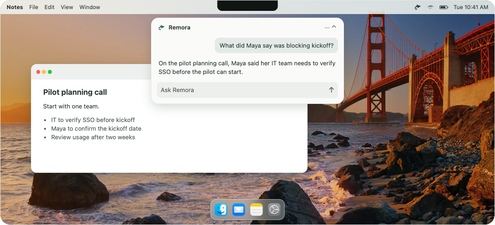
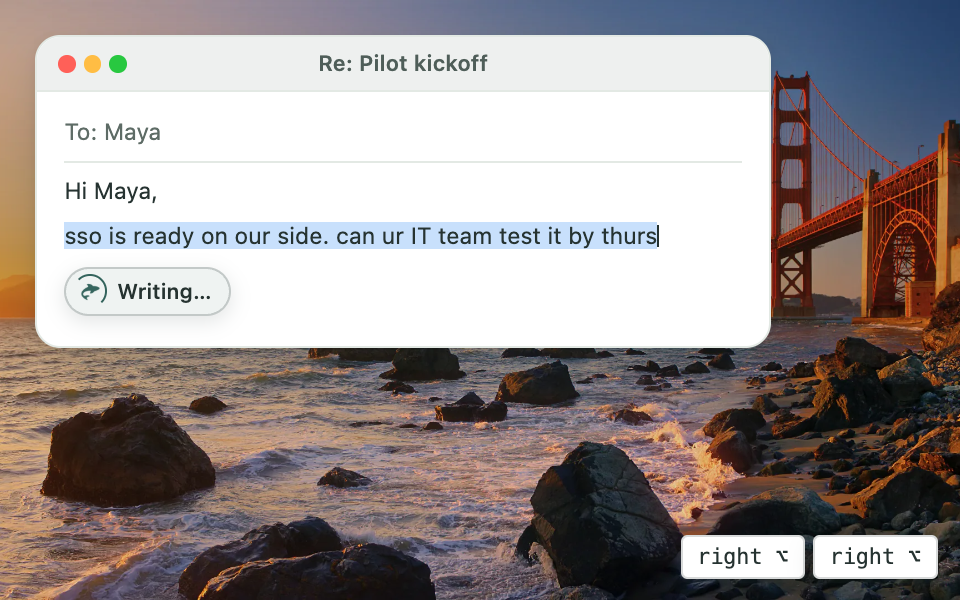
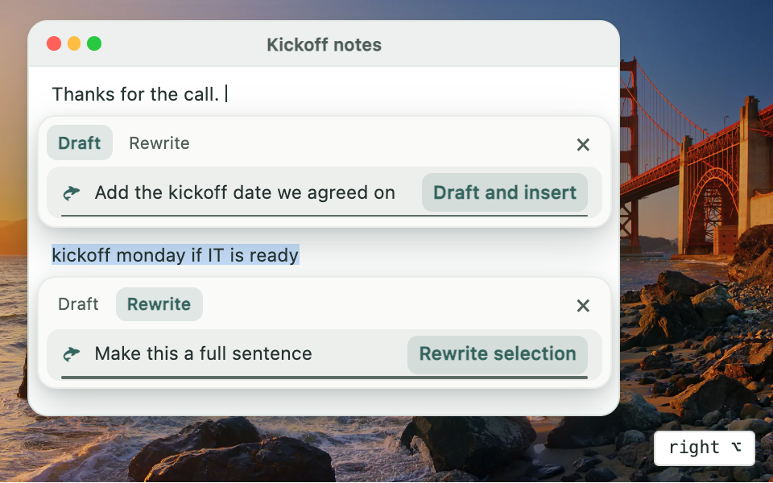
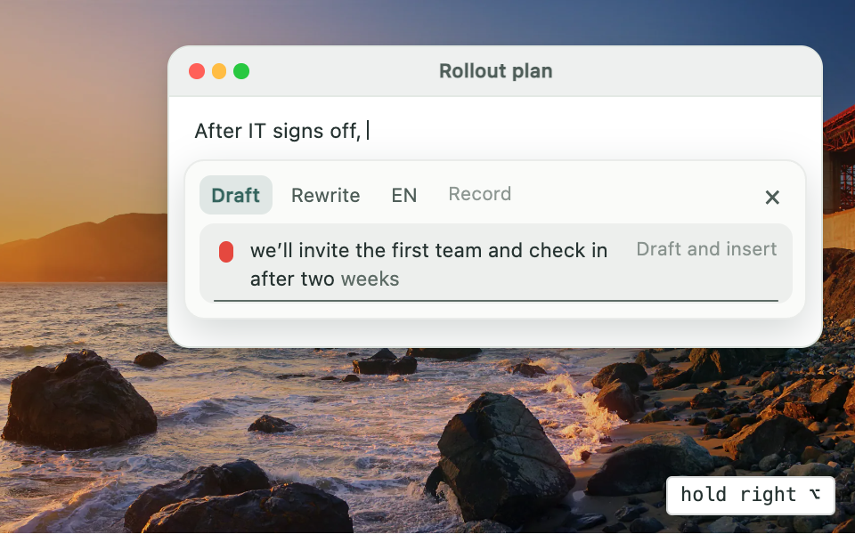
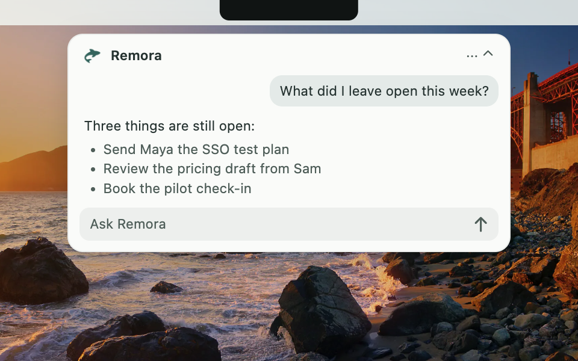

# Remora

Remora is a native macOS assistant that remembers what you see on screen and helps you write.



It reads the text of the window you are working in through the Accessibility API, keeps it in a local
database on your Mac, and has a language model organize it in the background into summaries, a
wiki of people and projects, and open items. You use that memory to rewrite or draft text in any
field with one key, to dictate, to ask questions in a chat bar under the notch, and to give other AI
apps read-only access over MCP. Remora uses your ChatGPT plan for rewrite, cleanup, memory, and chat.

| Rewrite in place | Draft or rewrite with a prompt |
|---|---|
|  |  |
| Double-tap **right ⌥** to rewrite the selection, or continue your sentence at the caret. | Tap **right ⌥** once for the writing popover: **Draft** writes new text from your prompt, **Rewrite** changes the selection. Tap again to switch. |
| **Speak where you type** | **Ask about your work** |
|  |  |
| Hold **right ⌥** to dictate, review the live transcript, then insert it or use it as an edit. | Open the chat bar to recall a decision, find what you left open, or see where your time went. |

Ask chat “What routines have you noticed?” for possible recurring work with dates and window
titles. You can rename or dismiss a suggestion, ask for a draft, or set a recurring prompt.
With Background memory and Proactive messages on, Remora checks in the background after seven
days of history and shows new findings in chat.

**Status:** a personal project, shared as is. It works for its author; expect rough edges, and
expect things to change between releases.

The [website and user documentation sources](docs/site/) include local preview and GitHub Pages
publishing instructions.

## Requirements

- macOS 26 or later.
- A ChatGPT plan that supports Sign in with ChatGPT.
- Apple silicon recommended. Some steps use Apple's on-device model, which needs Apple
  Intelligence. On a Mac without it (including Intel Macs), everything that would go to the cloud
  still works, but quick rewrites, Rewrite mode and dictation cleanup in excluded, private or unverifiable
  contexts fail closed with a notice: they never fall back to the cloud.

## Install

1. Download the `.dmg` from [GitHub Releases](https://github.com/redox/remora/releases).
2. Open it and launch Remora.
3. Accept "Move to Applications" (or drag Remora into Applications yourself). Remora has to run
   from `/Applications` or `~/Applications` so that permissions and updates stick.

## First run

A single onboarding window walks you through:

1. **Welcome**, with a short privacy summary.
2. **Accessibility** permission (required: it is how Remora reads and writes text).
3. **What Remora never reads**, and where your own exclusions live.
4. **Continue with ChatGPT** (you can choose Later).
5. **Try the key** in a practice field (when signed in).
6. **Dictation**, optional. Grant microphone permission to speak into the writing popover.
7. **Notifications**, for proactive messages.
8. **Done.** Memory fills in as you work.

Remora requires **Accessibility**. Dictation and meeting recording use **Microphone**.
Enabling meeting recording also requires macOS system audio recording permission.

## Writing and chat

- Tap **right ⌥** to open the writing popover in **Rewrite** for selected text or **Draft** at the
  caret. Type a prompt in **Draft** and press Return to draft text at the caret. When the
  footer says **Prompt only**, the model receives only the text you submit in the popover.
  Tap again to switch modes.
- Double-tap **right ⌥** with the popover closed to rewrite a selection. With nothing selected,
  Remora uses the text around the caret to continue the sentence or fill a gap.
- Click the bar under the notch or at the top center on displays without a notch. You can also
  choose **Open chat** from the Remora menu. Use the pin in the chat header to keep it open.

## Dictation

Hold **right ⌥** to dictate and release to review the transcript. In **Draft**, press Return to
draft from your spoken prompt, or choose **Insert transcript** to put your words into the field.
Tap the key to switch to **Rewrite** for changes to existing text. For hands-free dictation, click the
microphone beside the Return arrow, then click Stop to review the transcript.

Dictation uses the Mac's speech model for the live preview and final text by default. To use
OpenAI's `gpt-transcribe` for the final transcript, paste a project key into **Settings › Dictation ›
OpenAI transcription** and choose **Save and enable**. The key needs write access to
`POST /v1/audio/transcriptions`. Use a key from your linked API organization to draw on its credits.
Remora stores the key in Keychain. If automatic meeting recording is enabled, this key also
enables OpenAI transcription for new meetings. **Remove key** selects Mac transcription for future recordings.

OpenAI detects the language in eligible recordings after you choose **Insert transcript** with
the unchanged transcript. If the request fails, Remora uses the Mac transcript. Private, paused,
excluded or unverified contexts use Mac speech recognition. Drafting and editing from speech use
the reviewed text. Audio is held in memory. Transcript cleanup uses its own model setting.

## Privacy

- Background capture reads frontmost window text and copied text, skipping password fields,
  private windows, password managers, banking sites and anything you exclude.
- **Remember this** saves a selection you review in the writing popover. For ignored apps or sites,
  enable **Manual saves only** in Settings › Privacy. Search, paste or delete excerpts in
  Settings › Memory › Notes, with optional access in interactive chat.
- Secrets such as card numbers and API keys are replaced with `[redacted]` before anything is saved.
- Everything it captures stays in a local database on your Mac.
- Only the excerpts a task needs are sent to OpenAI, under your own ChatGPT account.
- A saved OpenAI transcription key sends eligible dictation audio and, when automatic meeting
  recording is enabled, eligible meeting audio to the transcription API under your API project.
- No telemetry, no analytics, no crash reporting. Details: [PRIVACY.md](PRIVACY.md).

## Usage costs

Settings › Usage shows **API-equivalent estimates**, not a bill: a ChatGPT plan has no per-token
price, and your real allowance is on ChatGPT's usage page. The built-in prices are OpenAI list
prices from [models.dev](https://models.dev), fetched 2026-11-20, with a long-context rate above
272k input tokens. `~/Library/Application Support/Remora/model-prices.json` overrides them field
by field (`null` keeps the built-in value). A model without a price shows no cost. The default
models are `gpt-6-luna` (small) and `gpt-6.1-terra` (large). JSON answers (MCP tools, chat tool
results) carry a `generated_by` field with the estimate.

## MCP

Settings › MCP connects Claude Code, Claude Desktop, Cursor and Codex to Remora's memory through
the bundled `remora-mcp` server. Access is read-only, and results are marked as untrusted data for
the client.

## Meeting sources

Turn on **Record meetings automatically** in Settings › Meeting sources to transcribe Google Meet
in regular Chrome, Zoom Workplace, and Microsoft Teams for Mac. Allow Accessibility, Microphone,
and system audio recording when prompted. Remora checks the meeting controls before starting. The menu bar shows recording status
and lets you stop for the rest of the call.

Without an OpenAI transcription key, choose English or French and install its Mac speech model.
With a key saved in **Settings › Dictation › OpenAI transcription**, Remora sends eligible meeting
audio to OpenAI in segments under your API project. OpenAI detects the language automatically.

Both modes capture the meeting app’s output and your microphone while the meeting shows it is
unmuted. For Meet, output can include audio from other Chrome tabs. Remora discards audio buffers
after use. Speaker names appear when captions match an utterance. Search or forget the transcript
in Meeting sources. An available on-device model generates notes, decisions, and action items.
Under **Recorded meetings**, enable **Use recordings in chat** to ask Remora about a call, or
**Share recordings with MCP clients** to let connected clients use `search_recorded_meetings`.
Both options are off by default and include existing recordings. Search returns dated excerpts.

To import existing notes, choose a start date and connect Quill, Granola or a compatible
local MCP server. For Quill, enable the local HTTP server in Quill Settings › MCP Server and paste
the URL it provides. Granola opens a browser for sign-in. The local MCP option speaks Streamable
HTTP over loopback and uses meeting list, notes and transcript tools with compatible schemas.

Remora imports available transcripts and generated notes, then periodically checks for new
meetings and edits to recent ones. You can sync an earlier date range manually. Search and forget
imports in the same Settings page. Enable chat access there if you want Remora chat to use meeting
excerpts through your ChatGPT account. Granola transcript availability depends on your plan and
workspace permissions. [Quill setup](https://www.quillmeetings.com/docs/mcp) ·
[Granola permissions](https://docs.granola.ai/help-center/sharing/integrations/mcp)

## Updates

Remora checks for updates every hour and installs them automatically when you are idle. Turn this
off in Settings › General ("Install updates automatically"), where "Check for Updates…" also lives.

## Uninstall

1. Disconnect meeting sources and remove Remora from each client in Settings › MCP.
2. Quit Remora from the menu bar.
3. Delete `Remora.app` from Applications.
4. Delete `~/Library/Application Support/Remora/` (the database, and `model-prices.json` if you
   created it) and `~/Library/Logs/Remora/`.
5. In Keychain Access, delete `dev.remora.Remora.siwc` (account `chatgpt`) and, if present,
   `dev.remora.meeting-import` (account `granola`) and `dev.remora.dictation-transcription`
   (account `openai`).

## Build from source

```sh
brew install xcodegen
make test     # unit tests (Swift package)
make build    # Debug app in build/Build/Products/Debug/Remora.app
```

Signing uses `Config/*.xcconfig`. To build with your own team, or ad-hoc without an Apple account,
copy `Config/Local.xcconfig.example` to `Config/Local.xcconfig` (gitignored) and pick one option.
See [CONTRIBUTING.md](CONTRIBUTING.md) for why a stable signing identity matters.

The architecture and its trade-offs are documented in [Remora design](docs/design.md).

## Legal

Not affiliated with OpenAI or Goldfish. ChatGPT is a trademark of OpenAI.

Remora is released under the [MIT License](LICENSE). Third-party licenses are in
[THIRD-PARTY-NOTICES.md](THIRD-PARTY-NOTICES.md).
